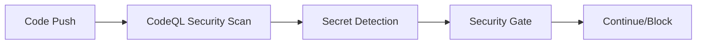
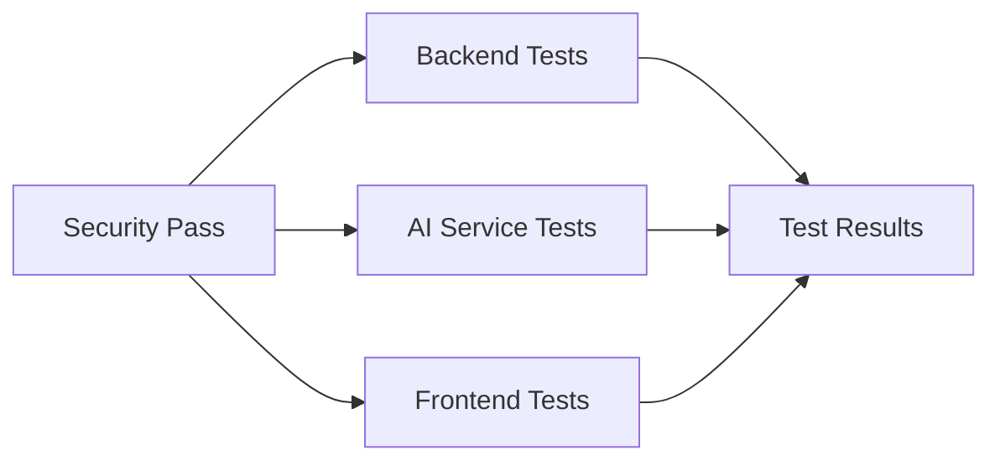
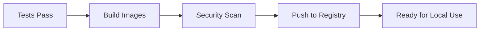

# 🚀 JobGenie Development CI Pipeline

## 📋 Overview

JobGenie implements a **development-focused CI pipeline** using GitHub Actions that's perfect for your current development stage:

- **🔍 Code Quality & Security**: CodeQL security scanning, secret detection
- **🧪 Testing**: Multi-language testing (Java, Python, TypeScript)
- **🐳 Docker**: Automated image building and security scanning
- **📦 Artifacts**: Ready-to-use builds for local development
- **🔒 Security**: Automated security scanning and compliance checks

## 🎯 **Why This Approach is Perfect for You**

### ✅ **What You Get (Development Benefits)**
- 🧪 **Automated testing** - catches bugs before they reach your local environment
- 🔒 **Security scanning** - prevents vulnerabilities from being committed
- 📊 **Code quality** - maintains consistent code standards
- 🐳 **Docker validation** - ensures your Docker images build correctly
- 📦 **Ready artifacts** - downloadable builds for local testing

### ⏳ **What You Skip (Deployment Complexity)**
- 🏗️ **No infrastructure setup** - no servers, domains, or hosting costs
- 🔧 **No deployment complexity** - focus on development, not operations
- 💰 **No additional costs** - uses GitHub's free tier
- ⏱️ **No time investment** - minimal setup, maximum benefit

## 📁 Workflow Files

### 1. `ci.yml` - Main Development CI Pipeline
**Triggers**: Push to main/modifications/develop, Pull Requests
**Features**:
- Security scanning with CodeQL
- Multi-language testing (Java, Python, TypeScript)
- Docker image building and security scanning
- Development summary and reporting

### 2. `security-scan.yml` - Security Scanning
**Triggers**: Daily at 2 AM UTC, Manual dispatch
**Features**:
- Dependency vulnerability scanning
- Secret detection with TruffleHog and Gitleaks
- Docker image security scanning
- Compliance and best practices checks

## 🔧 Setup Instructions

### 1. Required Secrets (Minimal)

You only need these basic secrets:

```bash
# GitHub automatically provides these
GITHUB_TOKEN (automatic)

# Optional: For enhanced security scanning
SONAR_TOKEN=your_sonarcloud_token (optional)
```

### 2. No Infrastructure Setup Required! 🎉

Unlike full CI/CD, you don't need:
- ❌ Staging servers
- ❌ Production servers
- ❌ Domain names
- ❌ SSL certificates
- ❌ Monitoring tools
- ❌ Deployment scripts

## 🚀 Usage

### Automatic CI (Recommended)
- **Every push** triggers the CI pipeline
- **Every pull request** runs tests automatically
- **Results** are visible in the Actions tab

### Manual CI
1. **Go to Actions tab** in your GitHub repository
2. **Select "JobGenie Development CI"**
3. **Click "Run workflow"**
4. **Choose branch** and click "Run workflow"

### Security Scanning
1. **Go to Actions tab**
2. **Select "Security Scanning"**
3. **Click "Run workflow"**
4. **Choose scan type**: all, dependencies, docker, or secrets

## 📊 Pipeline Stages

### 1. Code Quality & Security


### 2. Testing


### 3. Docker Build


## 🔍 What You Get

### Development Benefits
- **🧪 Test Validation**: Ensures all tests pass before merging
- **🔒 Security**: Catches vulnerabilities and secrets
- **📊 Quality**: Maintains code standards
- **🐳 Docker**: Validates container builds
- **📦 Artifacts**: Downloadable builds for testing

### Local Development Workflow
```bash
# 1. Develop locally
git add .
git commit -m "New feature"
git push origin feature/new-feature

# 2. CI runs automatically
# - Tests your code
# - Builds Docker images
# - Checks security
# - Reports results

# 3. Download artifacts for local testing
# - Go to Actions tab
# - Download backend-jars, frontend-build
# - Use in your local environment
```

## 🔒 Security Features

### Dependency Scanning
- **Java**: Maven dependency checks
- **Python**: Safety vulnerability scanner
- **Node.js**: npm audit

### Secret Detection
- **TruffleHog**: Git history scanning
- **Gitleaks**: Real-time secret detection
- **Custom rules**: Firebase, OpenAI, database credentials

### Docker Security
- **Trivy**: Container vulnerability scanning
- **Best practices**: Multi-stage builds, non-root users

## 📈 When to Add Full CI/CD

### Add Deployment When You Have:
- ✅ **Staging server** (VPS, cloud instance)
- ✅ **Production server** (VPS, cloud instance)
- ✅ **Domain names** (for public access)
- ✅ **SSL certificates** (for HTTPS)
- ✅ **Monitoring tools** (for health checks)

### Migration Path
1. **Current**: Development CI (what we have now)
2. **Next**: Add staging deployment
3. **Later**: Add production deployment
4. **Future**: Add monitoring and alerting

## 🛠️ Troubleshooting

### Common Issues

1. **Build Failures**
   ```bash
   # Check logs
   gh run list
   gh run view <run-id>
   ```

2. **Test Failures**
   ```bash
   # Run tests locally first
   cd JobGenie-Backend && mvn test
   cd JobGenie-AI && pytest
   cd JobGenie-Frontend && npm test
   ```

3. **Docker Build Failures**
   ```bash
   # Test Docker builds locally
   docker build -f JobGenie-Backend/api-gateway/Dockerfile .
   ```

### Debug Commands

```bash
# Check workflow status
gh run list --limit 10

# View specific workflow
gh run view <run-id> --log

# Rerun failed workflow
gh run rerun <run-id>

# Download artifacts
gh run download <run-id>
```

## 🎯 **Perfect for Your Situation**

This development CI approach is **ideal** because:

1. **🚀 Zero Infrastructure**: No servers, domains, or hosting needed
2. **💰 Zero Cost**: Uses GitHub's free tier
3. **⚡ Fast Setup**: Works immediately after push
4. **🔒 Security**: Catches issues early
5. **📊 Quality**: Maintains code standards
6. **🐳 Docker Ready**: Validates container builds
7. **📦 Artifacts**: Ready-to-use builds

## 🔄 Next Steps

### Immediate (What You Have Now)
- ✅ Development CI pipeline
- ✅ Security scanning
- ✅ Automated testing
- ✅ Docker validation

### Future (When You're Ready)
- 🚀 Staging deployment
- 🚀 Production deployment
- 📊 Health monitoring
- 🔔 Alerting system

## 📞 Support

For CI issues:
1. Check the Actions tab for detailed logs
2. Review the troubleshooting section
3. Check GitHub Actions documentation
4. The pipeline is designed to be self-explanatory

---

**🎉 You're all set! This CI pipeline will significantly improve your development workflow without any deployment complexity.** 